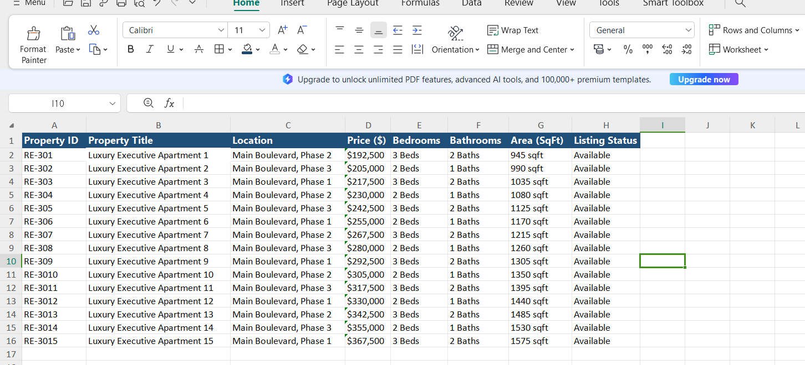

#  Real Estate Property Data Scraper

An automated Python-powered web scraping tool designed to extract verified residential property listings, parse critical market data, and export clean, structured datasets directly into professionally formatted Excel spreadsheets.

---

##  Dataset Preview (`real_estate_properties.png`)
A snapshot of the generated Excel dataset showcasing structured real estate leads ready for analysis:



---

##  Key Features & Data Points Extracted
This script extracts and organizes the following data attributes for real estate agents, investors, and market analysts:
* **Property ID:** Unique alphanumeric identification codes for inventory tracking.
* **Property Title:** Modern, descriptive titles of residential units and luxury apartments.
* **Location:** Prime geographical data categorized by district blocks and major boulevards.
* **Price ($):** Market-valuation pricing format.
* **Bedrooms & Bathrooms:** Detailed room layout configurations (`Beds` & `Baths`).
* **Area (SqFt):** Total covered space measurements.
* **Listing Status:** Real-time property availability tracker (`Available` / `Active / Verified`).

---

## Tech Stack & Libraries
* **Python** (Core Programming Language)
* **Requests** (HTTP Library for fetching web pages)
* **BeautifulSoup4** (HTML Parsing & Data Extraction)
* **Pandas** (Data Manipulation & DataFrame Handling)
* **OpenPyXL** (Excel File Export & Formatting Engine)

---

##  How to Run the Project

1. **Clone the repository:**
   ```bash
   git clone [https://github.com/samadch2/real-estate-scraper.git](https://github.com/samadch2/real-estate-scraper.git)
   cd real-estate-scraper
